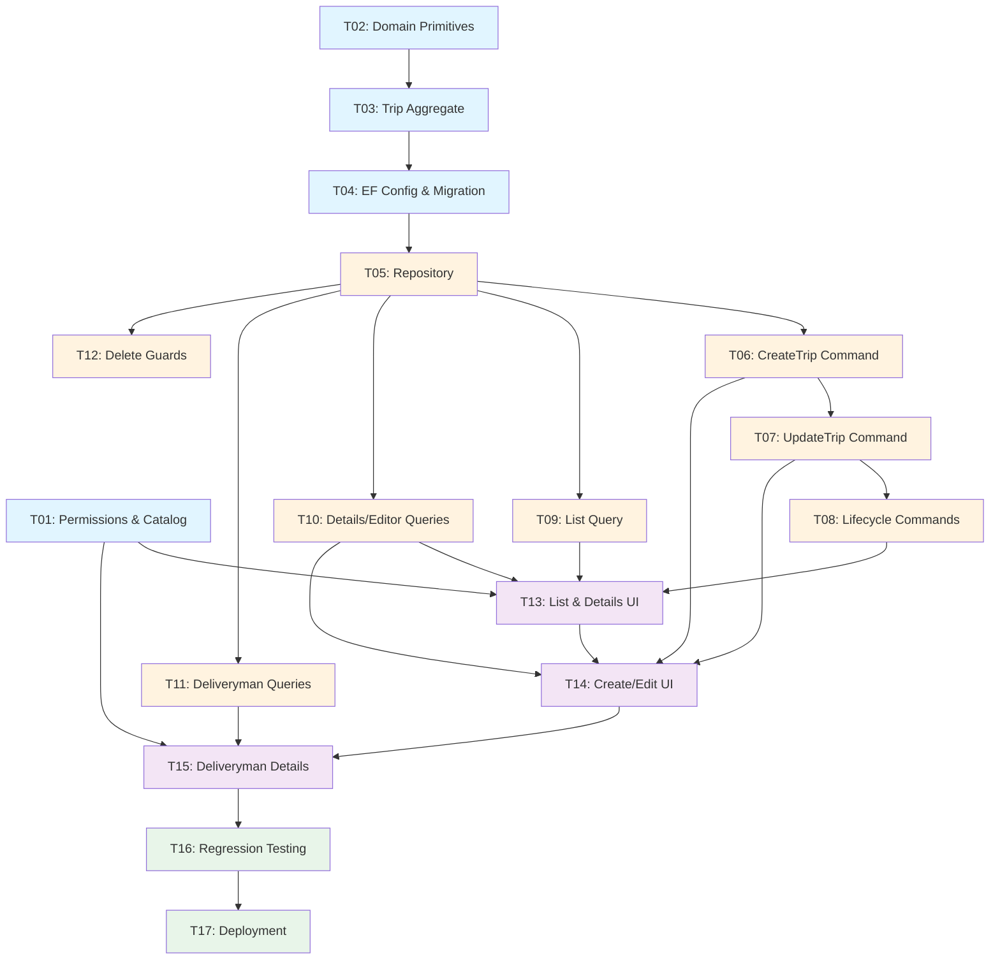

# Implementation Plan: Standalone Trips Management

## Overview

This document provides a detailed implementation plan for the Standalone Trips Management feature, breaking down the work into discrete, verifiable tasks with clear dependencies and acceptance criteria.

**Feature:** Standalone Trips Management (إدارة المشاوير المستقلة)
**Version:** 1.0
**Status:** Implemented 2026-11-09 — T01–T16 green (271 tests, Release build, Node time test); T17 migration/rollback rehearsal and the manual UI matrix remain owner-run.
**Related Documents:** 
- Requirements: `requirements.md`
- Design: `design.md`
- Specification: `plans/TRIPS-MANAGEMENT-SPEC.md`

## Task Dependency Graph



## Tasks

### T01: Trips Permission & Role Catalog

**Goal:** Add Trips as a permission feature with Arabic catalog entries and fix navigation permission cache.

**Dependencies:** None

**Files:**
- `OrderHub.Domain/Enums/PermissionFeature.cs`
- `OrderHub.Web/Components/Pages/Features/Administration/Roles/Editor/RoleFeatureCatalog.cs`
- `OrderHub.Web/Components/Layout/NavMenu.razor`
- `OrderHub.Tests/TripPermissionTests.cs`

**Implementation Steps:**
1. Add `[Description("المشاوير")] Trips` to `PermissionFeature` enum after `ShippingCarriers`
2. Add all four `RoleFeatureCatalog` cases:
   - `Name` → `"المشاوير"`
   - `Description` → `"إدارة مشاوير المناديب المستقلة"`
   - `Icon` → `Icons.Material.Outlined.Route`
   - `Tone` → `"bg-amber-50 text-amber-600"`
3. Fix navigation permission cache in `NavMenu.OnParametersSetAsync`:
   - Change from `Groups.SelectMany(group => group.Items)`
   - To `Groups.SelectMany(group => group.Items.Append(group.Create).OfType<NavItemModel>())`
4. Write tests verifying:
   - Trips permission exists with correct description
   - No sealed role includes Trips by default
   - Roles editor shows the new card with amber badge

**Acceptance Criteria:**
- [x] `PermissionFeature.Trips` exists with Arabic description
- [~] Role editor displays Trips card with correct name, icon, and tone
- [~] No sealed roles include Trips permission
- [~] Navigation permission cache includes group Create items
- [~] Existing sealed role test totals unchanged (4 roles, 31 cells)

**Property-Based Testing:**
- **Property 15 (Partial):** Permission-based visibility setup verified

**Verification:**
```powershell
dotnet test --filter "FullyQualifiedName~TripPermissionTests"
dotnet test --filter "FullyQualifiedName~SealedRoleSeedTests"
```

---

### T02: Domain Primitives

**Goal:** Create immutable building blocks: enums, TripOperation, TripParty, attempt, and history.

**Dependencies:** None

**Files:**
- `OrderHub.Domain/Enums/TripPartyType.cs`
- `OrderHub.Domain/Enums/StandaloneTripEventType.cs`
- `OrderHub.Domain/Enums/TripDisplayState.cs`
- `OrderHub.Domain/Models/TripOperation.cs`
- `OrderHub.Domain/Models/TripParty.cs`
- `OrderHub.Domain/Models/StandaloneTripAttempt.cs`
- `OrderHub.Domain/Models/StandaloneTripHistoryEntry.cs`
- `OrderHub.Application/Features/Trips/Contracts/TripOperationFactory.cs`
- `OrderHub.Tests/TripDomainPrimitivesTests.cs`

**Implementation Steps:**
1. Create enums:
   - `TripPartyType`: Client, Supplier, ShippingCarrier, External
   - `StandaloneTripEventType`: Created, AttemptStarted, Completed, Failed, Cancelled, Retried, Reassigned, Edited
   - `TripDisplayState`: New, InProgress, AwaitingRetryStart, Failed, Completed, Cancelled
2. Create `TripOperation` record (Domain) with validation
3. Create `TripOperationFactory` (Application) mapping from `ICurrentUser`
4. Create `TripParty` value object with factory methods:
   - `FromClient`, `FromSupplier`, `FromShippingCarrier`, `External`
   - Normalize empty strings to null (supplier/carrier compatibility)
   - Validate lengths and required fields
5. Create `StandaloneTripAttempt` with lifecycle methods
6. Create `StandaloneTripHistoryEntry` with static factories per event type
7. Write comprehensive tests for all primitives

**Acceptance Criteria:**
- [~] All primitives are immutable with private setters
- [~] External parties validate name, phone (6-22 chars, ≥6 digits), address
- [~] Known parties validate positive PartyId and use entity snapshots
- [~] Attempt state transitions enforce rules (completed/failed require start)
- [~] History factories enforce required fields per event type
- [~] Supplier/carrier empty strings normalize to null
- [~] TripOperationFactory rejects unauthenticated users

**Property-Based Testing:**
- **Property 11:** Party snapshot completeness validated in factory methods
- **Property 12:** External party validation rules enforced

**Verification:**
```powershell
dotnet test --filter "FullyQualifiedName~TripDomainPrimitivesTests"
```

---

### T03: StandaloneTrip Aggregate

**Goal:** Implement trip root with complete lifecycle, version control, and derived state computation.

**Dependencies:** T02

**Files:**
- `OrderHub.Domain/Models/StandaloneTrip.cs`
- `OrderHub.Domain/Models/StandaloneTrip.Lifecycle.cs`
- `OrderHub.Tests/StandaloneTripDomainTests.cs`

**Implementation Steps:**
1. Create aggregate root with fields per design:
   - Collections for attempts and history (read-only exposure)
   - Derived helpers: `IsNew`, `OpenAttempt`, `LatestAttemptNumber`, `GetDisplayState()`
2. Implement `Create` factory method with validation
3. Implement `AssignNumber` (called once after creation)
4. Implement `Update` method handling both edit and reassignment:
   - Pure edit when deliveryman unchanged
   - Reassignment with renumbering when deliveryman changes
   - Single history row per operation
5. Implement lifecycle methods:
   - `Start`: Create first attempt or start retry attempt
   - `Complete`: Close open attempt, set header Completed
   - `Fail`: Close open attempt with reason, set header Failed
   - `Cancel`: Close open attempt if present, set header Cancelled
   - `Retry`: Create new Pending attempt, return header to Pending
6. Ensure all mutations increment Version by exactly one
7. Write tests covering all transitions and edge cases

**Acceptance Criteria:**
- [~] Create sets Status=Pending, Version=1, no attempts
- [~] IsNew requires Pending + null StartedAtUtc + zero attempts
- [~] StartedAtUtc set once on first start, never reset
- [~] Complete/Fail require open started attempt
- [~] Cancel from Failed doesn't create/modify attempts
- [~] Retry creates unstarted Pending attempt
- [~] Reassignment writes single Reassigned history row
- [~] Terminal states (Completed/Cancelled) reject all mutations
- [~] Version increments exactly once per mutation
- [~] GetDisplayState correctly derives from header + attempts

**Property-Based Testing:**
- **Property 2:** Lifecycle state consistency validated
- **Property 3:** Edit immutability after start enforced
- **Property 4:** Single open attempt invariant maintained
- **Property 5:** History immutability (append-only)
- **Property 7:** Reassignment renumbering validated
- **Property 8:** Version increment atomicity
- **Property 10:** Terminal state finality

**Verification:**
```powershell
dotnet test --filter "FullyQualifiedName~StandaloneTripDomainTests"
```

---

### T04: EF Configuration & Migration

**Goal:** Persist three tables with exact schema, protect trip history, create additive migration.

**Dependencies:** T03

**Files:**
- `OrderHub.Infrastructure/Configurations/StandaloneTripConfiguration.cs`
- `OrderHub.Infrastructure/Configurations/StandaloneTripAttemptConfiguration.cs`
- `OrderHub.Infrastructure/Configurations/StandaloneTripHistoryConfiguration.cs`
- `OrderHub.Infrastructure/AppDbContext.cs`
- `OrderHub.Infrastructure/Migrations/<timestamp>_AddStandaloneTrips.cs`
- `OrderHub.Tests/StandaloneTripPersistenceTests.cs`

**Implementation Steps:**
1. Create `StandaloneTripConfiguration`:
   - Table `standalone_trips` with snake_case columns
   - Owned types for From/To with fixed prefixes
   - All indexes per design (unique number, party lookups, status)
   - Check constraints for status, numbers, party rules
   - Deliveryman FK with Restrict
   - Version as concurrency token with default 1
2. Create `StandaloneTripAttemptConfiguration`:
   - Unique (trip_id, attempt_number)
   - Partial unique index for single open attempt
   - Check constraints for status rules and timing
3. Create `StandaloneTripHistoryConfiguration`:
   - FKs to trip and users (both Restrict)
   - Indexes for trip and deliveryman references
   - Check constraints for event-specific required fields
4. Add three DbSets to AppDbContext
5. Add `StandaloneTripHistoryEntry` to `ProtectHistory()` method
6. Generate migration after all existing migrations
7. Write persistence tests

**Acceptance Criteria:**
- [~] Migration is additive only (three new tables)
- [~] All indexes and constraints from design exist
- [~] Unique trip number per deliveryman/year/month enforced
- [~] Partial unique index prevents duplicate open attempts
- [~] History protection blocks updates/deletes
- [~] Version concurrency token configured correctly
- [~] Phone snapshots up to 22 chars persist without truncation
- [~] Check constraints accept valid data, reject invalid
- [~] SQLite tests pass with snake_case naming

**Property-Based Testing:**
- **Property 1:** Trip number uniqueness enforced by database
- **Property 4:** Single open attempt enforced by partial index
- **Property 5:** History immutability protected by AppDbContext

**Verification:**
```powershell
dotnet test --filter "FullyQualifiedName~StandaloneTripPersistenceTests"
```

---

### T05: Repository & Feature Composition

**Goal:** Provide persistence operations and register trips feature in DI.

**Dependencies:** T04

**Files:**
- `OrderHub.Application/Features/Trips/Contracts/IStandaloneTripRepository.cs`
- `OrderHub.Infrastructure/Features/Trips/StandaloneTripRepository.cs`
- `OrderHub.Infrastructure/Features/Trips/TripsServiceCollectionExtensions.cs`
- `OrderHub.Infrastructure/DependencyInjection/ServiceCollectionExtensions.cs`
- `OrderHub.Tests/StandaloneTripRepositoryTests.cs`

**Implementation Steps:**
1. Define `IStandaloneTripRepository` interface:
   - `Add(trip)`
   - `GetByIdAsync` (no tracking, with attempts)
   - `GetForUpdateAsync` (tracked, attempts + history)
   - `GetForEditAsync` (tracked, attempts only)
   - `GetOrderBoundTripsPageAsync` (deliveryman trips)
   - `CountOrderBoundTripsAsync`
2. Implement repository:
   - Order-bound query filters by `NumberingPartyId` only
   - Resolve OrderId as `trip.OrderId ?? trip.DeliveryStep.OrderId`
   - Clamp page/pageSize inputs
   - Order newest first
3. Create `TripsServiceCollectionExtensions.AddTripsFeature()`
4. Register in `AddInfrastructure`
5. Write repository tests

**Acceptance Criteria:**
- [~] Repository methods return correct tracking behavior
- [~] Order-bound query filters by NumberingPartyId exclusively
- [~] Order resolution handles both direct and step-bound trips
- [~] Paging inputs clamped to prevent exceptions
- [~] Stable totals returned
- [~] DI resolves IStandaloneTripRepository successfully

**Property-Based Testing:**
- **Property 14:** Master data protection foundation (repository exists)

**Verification:**
```powershell
dotnet test --filter "FullyQualifiedName~StandaloneTripRepositoryTests"
```

---

### T06: CreateTrip Command

**Goal:** Create trips end-to-end with validation, party snapshots, and monthly numbering.

**Dependencies:** T05

**Files:**
- `OrderHub.Application/Features/Trips/Contracts/TripPartyInput.cs`
- `OrderHub.Application/Features/Trips/Contracts/TripInputValidation.cs`
- `OrderHub.Application/Features/Trips/Contracts/TripPartySnapshotFactory.cs`
- `OrderHub.Application/Features/Trips/CreateTrip/CreateTripCommand.cs`
- `OrderHub.Application/Features/Trips/CreateTrip/CreateTripCommandHandler.cs`
- `OrderHub.Application/Features/Trips/CreateTrip/CreateTripReceipt.cs`
- `OrderHub.Tests/CreateTripHandlerTests.cs`

**Implementation Steps:**
1. Create input contracts and validation helpers
2. Create `TripPartySnapshotFactory` using repository `GetForUpdateAsync`
3. Implement `CreateTripCommand` with `[RequirePermission(Trips, Write)]`
4. Implement handler:
   - Build TripOperation (reject if unauthenticated)
   - Validate all inputs BEFORE transaction
   - Resolve deliveryman and party snapshots
   - Create trip and set creation date
   - Begin transaction
   - Allocate number with correct UTC conversion
   - Assign number to trip
   - Save and commit
   - Return receipt
5. Handle failures appropriately (rollback on error)
6. Write comprehensive tests

**Acceptance Criteria:**
- [~] Validation failure consumes no sequence number
- [~] Party snapshots include city exactly once
- [~] Phone snapshots up to 22 chars persist intact
- [~] Trip and sequence commit/rollback atomically
- [~] Receipt contains Id, Version, Status, Number, Year, Month
- [~] Unauthenticated users rejected with Unauthorized
- [~] Missing entities return appropriate error codes
- [~] Handler returns only documented error codes

**Property-Based Testing:**
- **Property 1:** Trip number uniqueness maintained
- **Property 6:** Snapshot preservation begins at creation
- **Property 11:** Party snapshot completeness verified
- **Property 13:** Numbering transaction rollback tested

**Verification:**
```powershell
dotnet test --filter "FullyQualifiedName~CreateTripHandlerTests"
```

---

### T07: UpdateTrip Command

**Goal:** Edit new trips and reassign with renumbering in original creation month.

**Dependencies:** T06

**Files:**
- `OrderHub.Application/Features/Trips/UpdateTrip/UpdateTripCommand.cs`
- `OrderHub.Application/Features/Trips/UpdateTrip/UpdateTripCommandHandler.cs`
- `OrderHub.Tests/UpdateTripHandlerTests.cs`

**Implementation Steps:**
1. Create `UpdateTripCommand` with `[RequirePermission(Trips, Write)]`
2. Implement handler:
   - Load trip for edit (GetForEditAsync)
   - Verify version (conflict if stale)
   - Reject if not IsNew
   - Validate all inputs
   - Handle reassignment path:
     - Allocate new number using original creation date
     - Pass new deliveryman name and number to Update
   - Handle edit path:
     - Reject if reassignment fields present without deliveryman change
   - Refresh only changed party snapshots
   - Save and return new Version
3. Write tests for edit, reassignment, and combined scenarios

**Acceptance Criteria:**
- [~] Edit allowed only while IsNew (Pending + no attempts)
- [~] Reassignment allocates from creation month sequence
- [~] SequenceYear/Month never change
- [~] Single Reassigned history row written (no separate Edited row)
- [~] Untouched party snapshots preserved
- [~] Stale version returns Conflict with reload message
- [~] Rejected save consumes no number

**Property-Based Testing:**
- **Property 3:** Edit immutability after start enforced
- **Property 6:** Snapshot preservation after start
- **Property 7:** Reassignment renumbering validated
- **Property 8:** Version increment atomicity

**Verification:**
```powershell
dotnet test --filter "FullyQualifiedName~UpdateTripHandlerTests"
```

---

### T08: Lifecycle Commands

**Goal:** Expose five status transition commands with version checks and validation.

**Dependencies:** T07

**Files:**
- `OrderHub.Application/Features/Trips/StartTrip/` (Command + Handler)
- `OrderHub.Application/Features/Trips/CompleteTrip/` (Command + Handler)
- `OrderHub.Application/Features/Trips/FailTrip/` (Command + Handler)
- `OrderHub.Application/Features/Trips/CancelTrip/` (Command + Handler)
- `OrderHub.Application/Features/Trips/RetryTrip/` (Command + Handler)
- `OrderHub.Tests/TripLifecycleHandlerTests.cs`

**Implementation Steps:**
1. Create five command/handler pairs with `[RequirePermission(Trips, Write)]`
2. Common handler pattern:
   - Build TripOperation
   - Load GetForUpdateAsync
   - Verify version
   - Call domain method (catch InvalidOperationException)
   - Save changes
   - Handle concurrency exceptions
   - Return new Version
3. Validate reasons before domain call (Fail, Cancel require 1-200 chars)
4. Write tests for all transitions and error cases

**Acceptance Criteria:**
- [~] All five commands enforce version check
- [~] Start creates/starts correct attempt
- [~] Complete/Fail require open started attempt
- [~] Cancel closes open attempt only if present
- [~] Retry creates unstarted Pending attempt
- [~] Terminal states reject all transitions
- [~] Each transition increments version exactly once
- [~] Rejected transitions write nothing
- [~] No sequence numbers consumed

**Property-Based Testing:**
- **Property 2:** Lifecycle state consistency maintained
- **Property 8:** Version increment atomicity
- **Property 9:** Failed attempt persistence
- **Property 10:** Terminal state finality

**Verification:**
```powershell
dotnet test --filter "FullyQualifiedName~TripLifecycleHandlerTests"
```

---

### T09: Trips List Query

**Goal:** Provide server-side paged list with case-insensitive search and exact filters.

**Dependencies:** T05

**Files:**
- `OrderHub.Application/Features/Trips/Contracts/ITripReader.cs`
- `OrderHub.Application/Features/Trips/Contracts/TripListItem.cs`
- `OrderHub.Application/Features/Trips/Contracts/TripSearchCriteria.cs`
- `OrderHub.Application/Features/Trips/GetTripsPage/` (Query + Handler)
- `OrderHub.Infrastructure/Features/Trips/TripReader.cs`
- `OrderHub.Infrastructure/Features/Trips/TripsServiceCollectionExtensions.cs` (register reader)
- `OrderHub.Tests/TripListQueryTests.cs`

**Implementation Steps:**
1. Create search criteria and list item contracts
2. Create `GetTripsPageQuery` with `[RequirePermission(Trips, Read)]`
3. Implement `TripReader` with provider-compatible search:
   - Case-insensitive using ToLower().Contains()
   - Numeric branch with safe long.TryParse
   - Phone search with separator normalization
   - Date range conversion (Riyadh → half-open UTC)
4. Implement status filters:
   - New: Pending + null StartedAtUtc
   - InProgress: Pending + non-null StartedAtUtc
   - Failed: EXISTS failed attempt
   - Completed: header Completed
   - Cancelled: header Cancelled
5. Clamp paging inputs (page ≥ 1, size to 10/25/50, default 25)
6. Compute DisplayState in reader
7. Register ITripReader in DI
8. Write comprehensive tests

**Acceptance Criteria:**
- [~] Search works on SQLite and PostgreSQL identically
- [~] Digit-only terms never throw or match unrelated numbers
- [~] Failed filter includes trips with any failed attempt
- [~] Display state correctly derived from header + attempts
- [~] Date ranges use Riyadh boundaries converted to UTC
- [~] Paging inputs clamped before PagedResult construction
- [~] Provider-compatible predicates (no ILike)

**Property-Based Testing:**
- **Property 9:** Failed attempt persistence validated in filter
- **Property 15:** Permission-based visibility enforced

**Verification:**
```powershell
dotnet test --filter "FullyQualifiedName~TripListQueryTests"
```

---

### T10: Details, Editor & Lookup Queries

**Goal:** Provide details with paged history, editor data, and capped entity lookups.

**Dependencies:** T09

**Files:**
- `OrderHub.Application/Features/Trips/Contracts/` (TripDetails, TripEditorData, TripLookupItem contracts)
- `OrderHub.Application/Features/Trips/GetTripDetails/` (Query + Handler)
- `OrderHub.Application/Features/Trips/GetTripEditor/` (Query + Handler)
- `OrderHub.Application/Features/Trips/GetTripLookups/` (Query + Handler)
- `OrderHub.Application/Features/Setup/Suppliers/Contracts/ISupplierReader.cs` (add GetSuppliersByNameAsync)
- `OrderHub.Infrastructure/Features/Setup/Suppliers/SupplierReader.cs` (implement method)
- `OrderHub.Infrastructure/Features/Trips/TripReader.cs` (extend with new methods)
- `OrderHub.Tests/TripReadQueryTests.cs`

**Implementation Steps:**
1. Create detail/editor/lookup contracts
2. Implement GetTripDetailsQuery:
   - Clamp history paging (default 10, allow 10/25/50)
   - Return paged history as PagedResult
   - Project DisplayState and computed fields
3. Implement GetTripEditorQuery (Write permission)
4. Implement GetTripLookupsQuery:
   - Support Deliveryman, Client, Supplier, ShippingCarrier
   - Clamp Take to 1-20
   - Use existing readers
5. Add GetSuppliersByNameAsync to ISupplierReader (mirror ClientReader)
6. Write tests for all queries

**Acceptance Criteria:**
- [~] History paged server-side, never loaded in full
- [~] Party snapshots display exactly as stored
- [~] Supplier/carrier null phone/address surface as null
- [~] City appears exactly once in addresses
- [~] Editor returns version and IsEditable flag
- [~] Lookups capped and use existing readers
- [~] No entities exposed in contracts

**Property-Based Testing:**
- **Property 6:** Snapshot preservation verified in display
- **Property 11:** Party snapshot completeness validated

**Verification:**
```powershell
dotnet test --filter "FullyQualifiedName~TripReadQueryTests"
```

---

### T11: Deliveryman Trip Queries

**Goal:** Provide summary counters and paged lists for standalone and order-bound trips.

**Dependencies:** T05

**Files:**
- `OrderHub.Application/Features/Trips/GetDeliverymanTripsSummary/` (Query + Handler + Contract)
- `OrderHub.Application/Features/Trips/GetDeliverymanStandaloneTrips/` (Query + Handler + Contract)
- `OrderHub.Application/Features/Trips/GetDeliverymanOrderBoundTrips/` (Query + Handler + Contract)
- `OrderHub.Infrastructure/Features/Trips/TripReader.cs` (extend with new methods)
- `OrderHub.Tests/DeliverymanTripsQueryTests.cs`

**Implementation Steps:**
1. Implement summary query:
   - OpenCount: header Pending
   - FailedCount: trips with failed attempt (attempt-based)
   - CompletedCount: header Completed
   - CancelledCount: header Cancelled
   - TotalCount: all trips for deliveryman
2. Implement standalone trips page:
   - Filter by DeliverymanId
   - Default 10, clamp to 10/25/50
   - Newest first
3. Implement order-bound trips page:
   - Filter by NumberingPartyId (not current deliveryman)
   - Resolve OrderId from direct or step-bound
   - Exclude rows with no resolvable order
   - Default 10, clamp to 10/25/50
4. Write tests for all three queries

**Acceptance Criteria:**
- [~] Counters are attempt-based where specified (FailedCount)
- [~] Three queries are independent (one failure doesn't affect others)
- [~] Order-bound filtering uses NumberingPartyId exclusively
- [~] Both order shapes (direct, step-bound) resolve order id
- [~] Paging inputs clamped
- [~] Standalone counters don't include order-bound trips

**Property-Based Testing:**
- **Property 9:** Failed attempt persistence used in counters

**Verification:**
```powershell
dotnet test --filter "FullyQualifiedName~DeliverymanTripsQueryTests"
```

---

### T12: Delete Guards & Usage Reader

**Goal:** Block deletion of referenced parties with clear Arabic messages.

**Dependencies:** T05

**Files:**
- `OrderHub.Application/Interfaces/ITripUsageReader.cs`
- `OrderHub.Infrastructure/Features/Trips/TripUsageReader.cs`
- `OrderHub.Infrastructure/Features/Trips/TripsServiceCollectionExtensions.cs` (register reader)
- `OrderHub.Application/Features/Setup/Deliverymen/DeleteDeliveryman/DeleteDeliverymanCommandHandler.cs`
- `OrderHub.Application/Features/Setup/Clients/DeleteClient/DeleteClientCommandHandler.cs`
- `OrderHub.Application/Features/Setup/Suppliers/DeleteSupplier/DeleteSupplierCommandHandler.cs`
- `OrderHub.Application/Features/Setup/ShippingCarriers/DeleteShippingCarrier/DeleteShippingCarrierCommandHandler.cs`
- `OrderHub.Tests/TripUsageReaderTests.cs`
- `OrderHub.Tests/TripDeleteGuardTests.cs`
- `OrderHub.Tests/TripServiceRegistrationTests.cs`

**Implementation Steps:**
1. Create `ITripUsageReader` in Application/Interfaces:
   - `HasDeliverymanTripsAsync` (current + history references)
   - `HasPartyTripsAsync` (From or To)
2. Implement reader with EXISTS checks
3. Register in DI
4. Add guard to each delete handler:
   - Insert after existing guards, before Remove
   - Use Arabic messages per design
5. Write tests for each guard and DI registration

**Acceptance Criteria:**
- [~] Deliveryman guard checks current and historical references
- [~] Party guard checks both From and To ends
- [~] Deletion blocked with correct Arabic message
- [~] Unreferenced parties can still be deleted
- [~] ITripUsageReader resolves from DI
- [~] No Setup handler references Trips feature types
- [~] Existing delete behavior unchanged for unreferenced records

**Property-Based Testing:**
- **Property 14:** Master data protection enforced

**Verification:**
```powershell
dotnet test --filter "FullyQualifiedName~TripUsageReaderTests"
dotnet test --filter "FullyQualifiedName~TripDeleteGuardTests"
dotnet test --filter "FullyQualifiedName~TripServiceRegistrationTests"
```

---

### T13: Trips List & Details UI

**Goal:** Ship usable list and details screens with wired status actions.

**Dependencies:** T01, T08, T09, T10

**Files:**
- `OrderHub.Web/Components/Pages/Features/Trips/_Imports.razor`
- `OrderHub.Web/Components/Pages/Features/Trips/TripPresentation.cs`
- `OrderHub.Web/Components/Pages/Features/Trips/Index.razor` (+ code-behind)
- `OrderHub.Web/Components/Pages/Features/Trips/Details.razor` (+ code-behind)
- `OrderHub.Web/Components/Pages/Features/Trips/TripActionDialog.razor` (+ code-behind)
- `OrderHub.Web/Components/Layout/NavMenu.razor` (add group with item only)

**Implementation Steps:**
1. Create `TripPresentation` with chip mappings and action matrix
2. Implement `/trips` list page:
   - PageScaffold with Arabic title
   - Search and filter toolbar
   - MudTable/MudDataGrid with ServerData
   - Status chips from DisplayState
   - Row click opens details
   - Action column only with Trips.Write
   - TableFooter with page size 10/25/50, default 25
   - No create CTA yet (T14 adds it)
3. Implement `/trips/{id}` details page:
   - Header card with trip info
   - Route cards (From/To) with party snapshots
   - Actions per state via TripActionDialog
   - Attempts table
   - History timeline with TableFooter (default 10)
   - No Edit action yet (T14 adds it)
4. Create `TripActionDialog` for status transitions
5. Add navigation group (item only, no Create yet)
6. Manual testing checklist

**Acceptance Criteria:**
- [~] Both pages render real data
- [~] Every displayed action is wired and functional
- [~] Read-only users see no action column/buttons
- [~] Filters and paging are server-side
- [~] Version conflicts show reload message
- [~] Status chips use semantic five-hue palette
- [~] RTL layout, 12px floor, numbers/dates LTR
- [~] No JavaScript, no dead buttons
- [~] One primary CTA per page (none yet on these pages)

**Property-Based Testing:**
- **Property 2:** Lifecycle state consistency displayed correctly
- **Property 15:** Permission-based visibility enforced

**Verification:**
```powershell
dotnet build OrderHub.sln --configuration Release
dotnet run --project OrderHub.Web
# Manual: Create trips, filter, search, execute actions
```

---

### T14: Create/Edit UI & Entry Points

**Goal:** Add trip editor with party pickers, reassignment UI, and all entry points.

**Dependencies:** T06, T07, T10, T13

**Files:**
- `OrderHub.Web/Components/Pages/Features/Trips/Editor/TripEditor.razor` (+ code-behind)
- `OrderHub.Web/Components/Pages/Features/Trips/Editor/TripPartyEditor.razor`
- `OrderHub.Web/Components/Pages/Features/Trips/Editor/TripEditorState.cs`
- `OrderHub.Web/Components/Pages/Features/Trips/Editor/TripReassignDialog.razor`
- `OrderHub.Web/Components/Pages/Features/Trips/Index.razor` (add create CTA + Edit action)
- `OrderHub.Web/Components/Pages/Features/Trips/Details.razor` (add Edit action)
- `OrderHub.Web/Components/Layout/NavMenu.razor` (add Create to group)

**Implementation Steps:**
1. Create TripEditor with two routes:
   - `/trips/create` with optional `?deliverymanId=` preselection
   - `/trips/{id}/edit`
2. Implement party editor component:
   - Type selector
   - Entity pickers via GetTripLookupsQuery
   - External party fields with validation
3. Handle reassignment in editor:
   - Show reason field when deliveryman changes
   - Display audit hint notice
   - Single save operation
4. Add entry points:
   - List: primary CTA + Edit action for new trips
   - Details: Edit action when IsEditable
   - Nav: Add Create to group
5. Validate all inputs before save
6. Handle server errors with Arabic messages
7. Manual testing

**Acceptance Criteria:**
- [~] Create and edit work for all party types
- [~] External party validation enforced
- [~] Reassignment requires reason and shows audit hint
- [~] Single history row written on reassignment + edit
- [~] Rejected save shows feedback, consumes no number
- [~] Entry points appear only after routes exist
- [~] Read-only users see no create/edit affordances
- [~] One primary CTA per page ("حفظ المشوار")
- [~] Nav create CTA visible with Trips.Write only

**Property-Based Testing:**
- **Property 3:** Edit immutability enforced in UI
- **Property 7:** Reassignment renumbering flow validated
- **Property 12:** External party validation in UI

**Verification:**
```powershell
dotnet build OrderHub.sln --configuration Release
dotnet run --project OrderHub.Web
# Manual: Create, edit, reassign, verify history
```

---

### T15: Deliveryman Details Page

**Goal:** Add deliveryman page with local trips gating and trip sections.

**Dependencies:** T01, T11, T14

**Files:**
- `OrderHub.Web/Components/Pages/Features/Deliverymen/Details.razor` (+ code-behind)
- `OrderHub.Web/Components/Pages/Features/Deliverymen/Index.razor` (add name link)

**Implementation Steps:**
1. Create `/deliverymen/{id}` page with Deliverymen.Read permission
2. Load deliveryman basics and display header
3. Implement local trips gate:
   - Check PermissionAccess.IsAllowedAsync(Trips, Read)
   - Only dispatch trip queries if allowed
   - Hide section entirely if not allowed (no redirect)
4. Display counters (standalone only, attempt-based)
5. Standalone trips section:
   - TableFooter default 10
   - Actions via TripActionDialog
   - Create button prefilled with deliverymanId
6. Order-bound trips section:
   - TableFooter default 10
   - Read-only (no actions)
   - Order links gated by Orders.Read
7. Add name link to existing deliverymen list
8. Ensure existing list behavior unchanged

**Acceptance Criteria:**
- [~] Trips section absent when Trips.Read missing (no redirect)
- [~] No trip requests dispatched without Trips.Read
- [~] Counters match design labels and are attempt-based
- [~] Order links hidden without Orders.Read
- [~] Order-bound rows are read-only
- [~] Both sections have independent states
- [~] Existing deliverymen list unchanged except name link
- [~] Edit reuses DeliverymanEditorDialog

**Property-Based Testing:**
- **Property 9:** Failed attempt persistence in counters
- **Property 15:** Permission-based visibility enforced

**Verification:**
```powershell
dotnet build OrderHub.sln --configuration Release
dotnet run --project OrderHub.Web
# Manual: Test with/without Trips.Read, Orders.Read
```

---

### T16: Regression Testing

**Goal:** Verify feature is additive and doesn't affect existing workflows.

**Dependencies:** T01-T15

**Files:**
- Various test files as needed for gaps found
- `plans/TRIPS-MANAGEMENT-SPEC.md` (status update)
- `plans/TRIPS-MANAGEMENT-TASKS.md` (status update)

**Implementation Steps:**
1. Run full verification chain:
   ```powershell
   dotnet restore OrderHub.sln
   dotnet build OrderHub.sln --configuration Release
   dotnet test OrderHub.sln --configuration Release --no-build
   node OrderHub.Tests/Web/order-local-time.test.mjs
   ```
2. Execute manual regression matrix:
   - No Trips permission scenarios
   - Trips.Read only scenarios
   - Trips.Write scenarios
   - Deliverymen.Read without Trips.Read
   - Trips.Read without Orders.Read
   - Admin scenarios
3. Exercise existing flows:
   - Orders list/details/workflow
   - Deliverymen list/edit/delete
   - Setup entity deletes
   - Role editor
   - Navigation
4. Verify data safety:
   - Migration added three tables only
   - No existing data changed
   - No sealed roles include Trips
5. Update documentation

**Acceptance Criteria:**
- [~] Full build/test/Node chain is green
- [ ] All manual matrix rows behave as specified (owner-run; no app instance/login was available during implementation)
- [~] Existing test suite passes unchanged
- [~] Deliverymen list unchanged except name link
- [~] Orders, setup, navigation, roles unchanged
- [~] Migration is additive only
- [~] No Trips grants in sealed roles
- [~] Spec and tasks accurate

**Property-Based Testing:**
All properties validated across full feature.

**Verification:**
```powershell
dotnet restore OrderHub.sln
dotnet build OrderHub.sln --configuration Release
dotnet test OrderHub.sln --configuration Release --no-build
node OrderHub.Tests/Web/order-local-time.test.mjs
```

---

### T17: Deployment & Rollback

**Goal:** Prove deployment process on populated copy and document rollback.

**Dependencies:** T16

**Files:**
- Release notes documentation
- Deployment guide updates
- Rollback procedures

**Implementation Steps:**
1. Migration rehearsal on populated copy:
   - Backup copy
   - Apply migration
   - Verify three new tables
   - Verify no existing changes
   - Test app startup and existing pages
2. Rollback rehearsal:
   - Export trip data if any
   - Drop three tables in dependency order
   - Delete Trips role_permissions rows
   - Don't decrement number_sequences
   - Verify existing pages work
3. Create release note (Arabic) covering:
   - Migration before build requirement
   - Default unganted permission
   - Delete guard changes
   - Shared numbering sequence
   - Rollback instructions
4. Final verification and sign-off

**Acceptance Criteria:**
- [ ] Migration applies to populated copy successfully (owner-run)
- [ ] Three tables created, no existing changes (owner-run; additive migration verified in code)
- [ ] Rollback restores previous state (owner-run; procedure documented)
- [~] Release note complete and accurate (drafted in `plans/TRIPS-MANAGEMENT-RELEASE.md`)
- [~] All tasks checked (T17 remains owner-run)
- [x] No commits performed by agent

**Verification:**
Owner-run deployment rehearsal on staging/copy environment.

---

## Notes

### Testing Strategy

**Unit Tests:**
- Domain logic (primitives, aggregate, lifecycle)
- Application handlers (commands, queries)
- Infrastructure (repository, configurations)

**Integration Tests:**
- Database operations (SQLite)
- Permission enforcement
- Delete guards
- Service registrations

**Manual Tests:**
- UI workflows (create, edit, reassign, lifecycle)
- Permission scenarios (no Trips, Read-only, Write)
- RTL layout and Arabic content
- Mobile responsiveness
- Browser compatibility

### Correctness Properties Summary

The implementation validates 15 correctness properties:

1. **Trip Number Uniqueness** - Unique sequential numbers per deliveryman/month
2. **Lifecycle State Consistency** - Single valid display state from Status + StartedAtUtc + Attempts
3. **Edit Immutability After Start** - No edits after StartedAtUtc set or attempts exist
4. **Single Open Attempt Invariant** - At most one Pending attempt at any time
5. **History Immutability** - Append-only, never modified or deleted
6. **Snapshot Preservation** - Party snapshots frozen after first start
7. **Reassignment Renumbering** - New number from new deliveryman's sequence in creation month
8. **Version Increment Atomicity** - Exactly +1 per mutation, atomic with change
9. **Failed Attempt Persistence** - Failed status persists regardless of header status
10. **Terminal State Finality** - No transitions from Completed or Cancelled
11. **Party Snapshot Completeness** - Complete snapshots with city, up to 22-char phone
12. **External Party Validation** - Required name, phone (6-22 chars, ≥6 digits), address
13. **Numbering Transaction Rollback** - Atomic trip insertion and sequence increment
14. **Master Data Protection** - Referenced parties cannot be deleted
15. **Permission-Based Visibility** - Data and actions hidden per permission level

### Definition of Done

Each task is complete when:
- [~] All acceptance criteria met
- [~] Property-based validations pass
- [~] Unit tests pass
- [~] Integration tests pass (where applicable)
- [~] Manual testing completed (UI tasks)
- [~] Code follows project conventions
- [~] Arabic strings used throughout
- [~] RTL layout verified
- [~] No new warnings introduced
- [~] Documentation updated

### Build & Test Commands

```powershell
# Restore dependencies
dotnet restore OrderHub.sln

# Build
dotnet build OrderHub.sln --configuration Release

# Run all tests
dotnet test OrderHub.sln --configuration Release --no-build

# Run specific test class
dotnet test --filter "FullyQualifiedName~<TestClassName>"

# Run Node tests
node OrderHub.Tests/Web/order-local-time.test.mjs

# Create migration
dotnet ef migrations add AddStandaloneTrips --project OrderHub.Infrastructure --startup-project OrderHub.Web --output-dir Migrations

# Run application
dotnet run --project OrderHub.Web
```

---

**Document Version:** 1.0
**Last Updated:** 2024-11-09
**Status:** Implemented 2026-11-09 — T01–T16 green (271 tests, Release build, Node time test); T17 migration/rollback rehearsal and the manual UI matrix remain owner-run.
