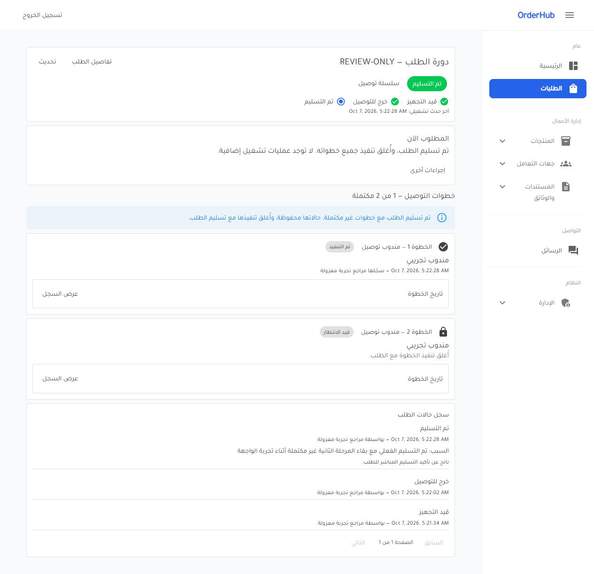

# نتيجة تنفيذ دورة الطلب والتوصيل

## النتيجة

نُفذت الميزة من Domain إلى قاعدة البيانات والCommands والقراءات وواجهة Web وفق [خطة التنفيذ](order-lifecycle-implementation-plan.md). كل مهمة أُغلقت بعد تحققها وcommit مستقل. لم تُطبّق migrations على قاعدة المصدر الأصلية، ولم تُنشر الخدمة أو تُدفع commits إلى remote.

## ما أصبح متاحًا

- Processing عند الإنشاء وتاريخ أول بنفس الوقت، وسجل حالات ثابت للطلب والخطوات بمستخدم العملية ووقت UTC من السيرفر.
- عمليات تسليم مقيدة بحسب طريقة التوصيل، فشل وإعادة محاولة وتسلسل خطوات، وتسليم مباشر باختيارات منفصلة يسمح ببقاء خطوات غير مكتملة.
- قفل البيانات والدفع بعد بدء التسليم، وعدم إعادة فتح المكتمل أو الملغى، وحماية من تجاوز القفل عبر الأبناء أو commands القديمة.
- أسباب إلزامية حتى 200 حرف، تحكم بالتزامن ونسخة لكل تعديل، وحفظ ذري دون تاريخ أو خطوات جزئية.
- أرشفة نهائية تحافظ على البيانات والمستندات، قائمة مستقلة للمؤرشف وقراءات تاريخ مقسمة. لا حذف فعلي أو استعادة.
- صفحة workflow توضح المطلوب والخطوات والإجراءات المتاحة، وحوارات تشرح الأثر وتحفظ المدخلات عند خطأ الحفظ. التاريخ يُعرض بوقت المتصفح.
- ترحيل البيانات القديمة مع الحفاظ على المعرفات والقيم التجارية ووقت الإنشاء. حالات نهائية وخطواتها تتحول وفق القواعد، مع تمييز التاريخ المرحّل.
- إصلاح تحديث خطوات التوصيل مع الاحتفاظ بهويتها، race أرقام الطلبات، إعادة إرسال الإنشاء، تعارضات الصلاحيات القديمة، ومعالجة فشل commit دون rollback ثانٍ يخفي الخطأ.
- إزالة رابط لوحة تحكم قديم غير موجود وحاجز الأجهزة القديم الذي تعارض مع التصميم المتجاوب المعتمد.

## التحقق

الاختبارات النهائية: **557 ناجحًا، صفر إخفاقات، صفر اختبارات متخطاة**. أزيلت 21 حالة اختبار تخص حاجز الأجهزة المتقاعد، وأضيف اختباران لفشل commit وتجربة المصدر الفعلية؛ لم تُخفَ اختبارات فاشلة أو تُتخطَّ اختبارات PostgreSQL. يشمل التحقق Domain/Application/Web وPostgreSQL حقيقي وschema/migration/concurrency/atomicity، واختبار JavaScript ناجح للتوقيت المحلي وحدود أيام التوقيت الصيفي. لا model drift في EF.

بناء الحل بوضع Release ناجح دون أخطاء. المقارنة النهائية لـGit سليمة دون أخطاء whitespace.

تجربة [الاستعادة والترحيل](order-lifecycle-task-11-rehearsal.md) استخدمت snapshot قراءة فقط ثم pg_dump/pg_restore إلى قاعدة عشوائية معزولة. تطابقت بصمات جميع القيم الأصلية قبل/بعد؛ بقيت 15 طلبًا و18 بندًا و6 خطوات وفاتورة واحدة، وتحولت الطلبات كلها إلى Processing مع 15 سجلًا مرحّلًا. جُرّب ملف الإصدار idempotent مرتين دون تكرار التاريخ. القاعدة وملف النسخة المؤقت أُزيلا.

المصدر الحقيقي لا يحتوي حالات نهائية؛ اختبار migration منفصل غطى Delivered/Cancelled وبقية الحالات القديمة، حفظ المعرفات والبنود والفاتورة ووقت الإنشاء، ورفض التواريخ غير المحدودة دون أثر جزئي.

## مراجعة الواجهة الفعلية

جرى تسجيل الدخول إلى Web يعمل على النسخة المعزولة بحساب تجريبي، وبدء سلسلة من خطوتين. قُفلت البيانات وبدأت الخطوة الأولى. في التسليم المباشر اختير إكمال الأولى وإبقاء الثانية Pending، مع السبب؛ عرض الحوار أثر الاختيارات قبل التأكيد. ظهر الطلب Delivered والخطوة الثانية غير مكتملة ومقفولة، مع المستخدم والسبب والتاريخ. ثم أُرشف بسبب إلزامي وظهر في قائمة المؤرشف دون استعادة أو تعديل.

فُحص العرض بعرض 390px؛ المراحل والخطوات والتحذير والتاريخ تلتف رأسيًا دون ازدحام. هذا فحص متصفح مكتبي بعرض ضيق؛ طلبات HTTP بتعريف هاتف اختُبرت أيضًا. لم تُجرّب أجهزة هاتف فعلية.

## حدود التحقق وخطوة الإصدار

هذه الأدلة تخص قاعدة التطوير المحلية وبيانات اختبار معزولة، وليست تحققًا من production أو اختبار ضغط أو ضمانًا لغياب كل خطأ محتمل. بناء WPF المتقاعد ليس ضمن الحل المختبر، وكتابته للطلبات أُغلقت بدل إبقاء مدخل يخالف القواعد.

النشر وترحيل القاعدة الفعلية لم يحدثا. توجد [خطة إصدار وتراجع](order-lifecycle-release-runbook.md) و[SQL إصدار مجرّب](order-lifecycle-release.sql). يلزم إيقاف الكتابة القديمة ونسخة احتياطية حديثة متحقق من استعادتها، ثم المخطط، ثم الكود. بعد وجود تاريخ جديد يكون الإصلاح الأمامي هو المسار الأول؛ لا Down يمحو التاريخ ولا استعادة تفقد العمليات الجديدة دون قرار صريح.
