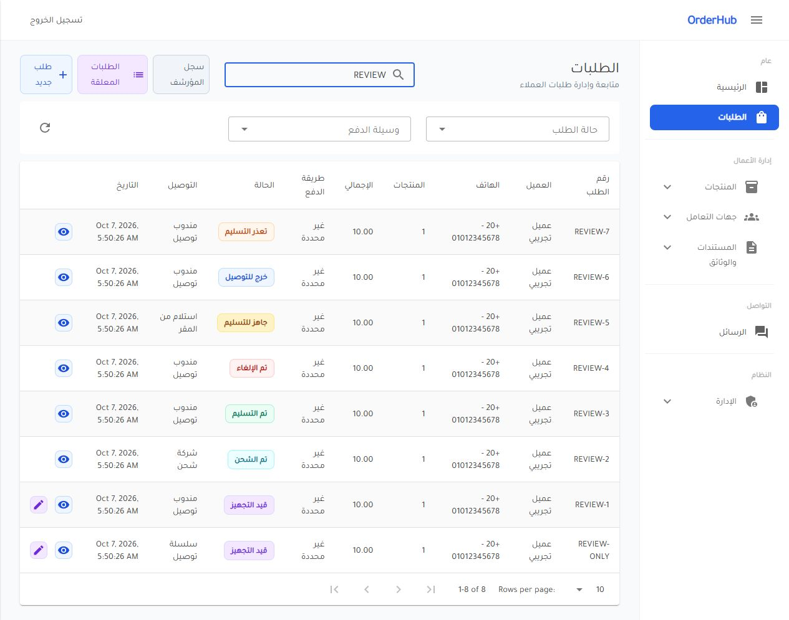
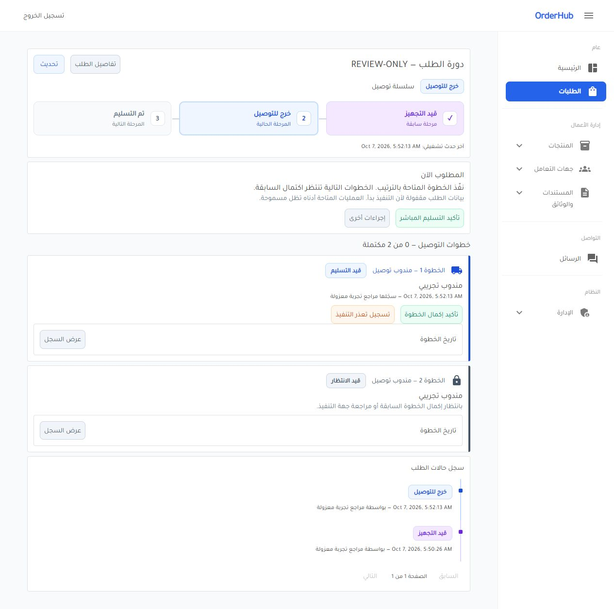
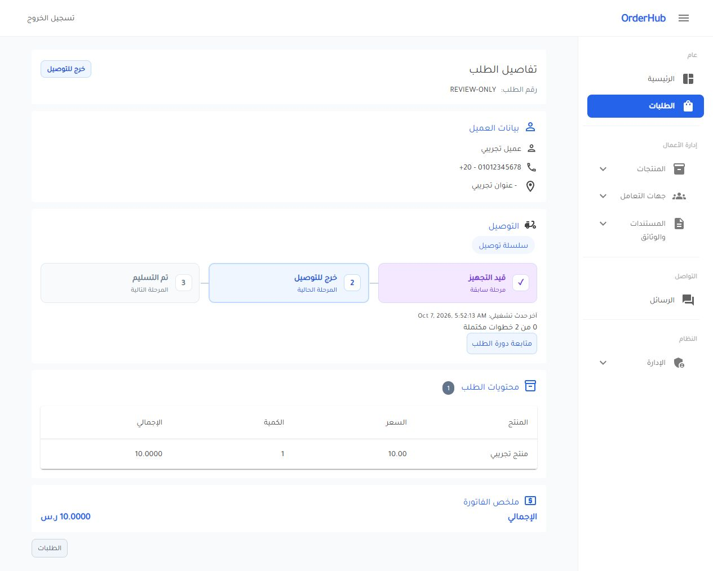

# مراجعة ألوان وتصميم دورة الطلب

نُفذت ملاحظات المستخدم بعد قبول عمل الميزة: التغيير خاص بالعرض في قائمة الطلبات والتفاصيل ودورة الطلب وحواراتها، دون تعديل حالات الأعمال أو شروط التشغيل أو قاعدة البيانات.

## نظام الألوان

كل حالة لها نص واضح وخلفية فاتحة وحدود من نفس اللون، من stylesheet واحد مشترك:

| الحالة | لون النص | الخلفية |
|---|---|---|
| قيد التجهيز | بنفسجي `#6d28d9` | `#f3e8ff` |
| جاهز للتسليم | كهرماني `#92400e` | `#fef3c7` |
| خرج للتوصيل | أزرق `#1d4ed8` | `#eff6ff` |
| تم الشحن | سماوي `#0e7490` | `#ecfeff` |
| تم التسليم | أخضر `#047857` | `#ecfdf5` |
| تعذر التسليم | برتقالي `#c2410c` | `#fff7ed` |
| تم الإلغاء | أحمر `#b91c1c` | `#fef2f2` |
| المؤرشف / الانتظار | رمادي `#475569` | `#f1f5f9` |

ألوان الخطوات متسقة مع الطلب: التنفيذ أزرق، المكتمل أخضر، التعذر برتقالي، الإلغاء أحمر، والانتظار رمادي. الأزرار تستخدم خلفية خفيفة ونصًا وحدودًا مناسبين لمعنى الإجراء، مع حالة تعطيل محايدة وfocus واضح للوحة المفاتيح.

## المراحل والتاريخ

- استُبدلت أيقونات radio بمراحل مرقمة في بطاقات مترابطة؛ المرحلة الحالية لها حد أوضح، والسابقة علامة تحقق، والقادمة محايدة. المراحل للعرض، وليست خيارات لتغيير الحالة.
- تتجه البطاقات رأسيًا في العرض الضيق، مع بقاء ترتيب RTL والربط بينها.
- سجل التاريخ أصبح خطًا رأسيًا بعلامات مربعة صغيرة وشارات حالات ملونة، مع الوقت والمستخدم والسبب ونوع الحدث كما كانت.
- لم تتغير صلاحيات التشغيل أو قفل البيانات أو الحوار أو اختيارات التسليم أو الحفظ.

## التحقق والأدلة

اختبارات العرض والحوارات: 8 ناجحة. المراجعة البصرية الفعلية تمت على قاعدة مستعادة معزولة وحساب وطلبات اصطناعية، تشمل الحالات السبع، الصفحات الثلاث، و390px. بدء التوصيل والخطوة استمرا في العمل مع القفل وتسلسل الخطوات. لا كتابة على قاعدة المصدر من المراجعة.

التحقق النهائي للحل: **557 اختبارًا ناجحًا، دون إخفاق أو تخطٍ**، مع تفعيل اختبارات PostgreSQL وتجربة الاستعادة على المصدر الحالي. البناء ناجح، وGit diff بلا أخطاء whitespace.

حُدث اختبار النسخ والاستعادة ليستوعب المصدر بعد استخدام النظام الجديد أيضًا، ويحافظ على التاريخ والحالات التشغيلية الموجودة؛ لم يعد يفترض أن كل تاريخ في المصدر مرحّل. بيانات عرض الألوان تُضاف إلى النسخة المعزولة فقط أثناء المراجعة اليدوية.

